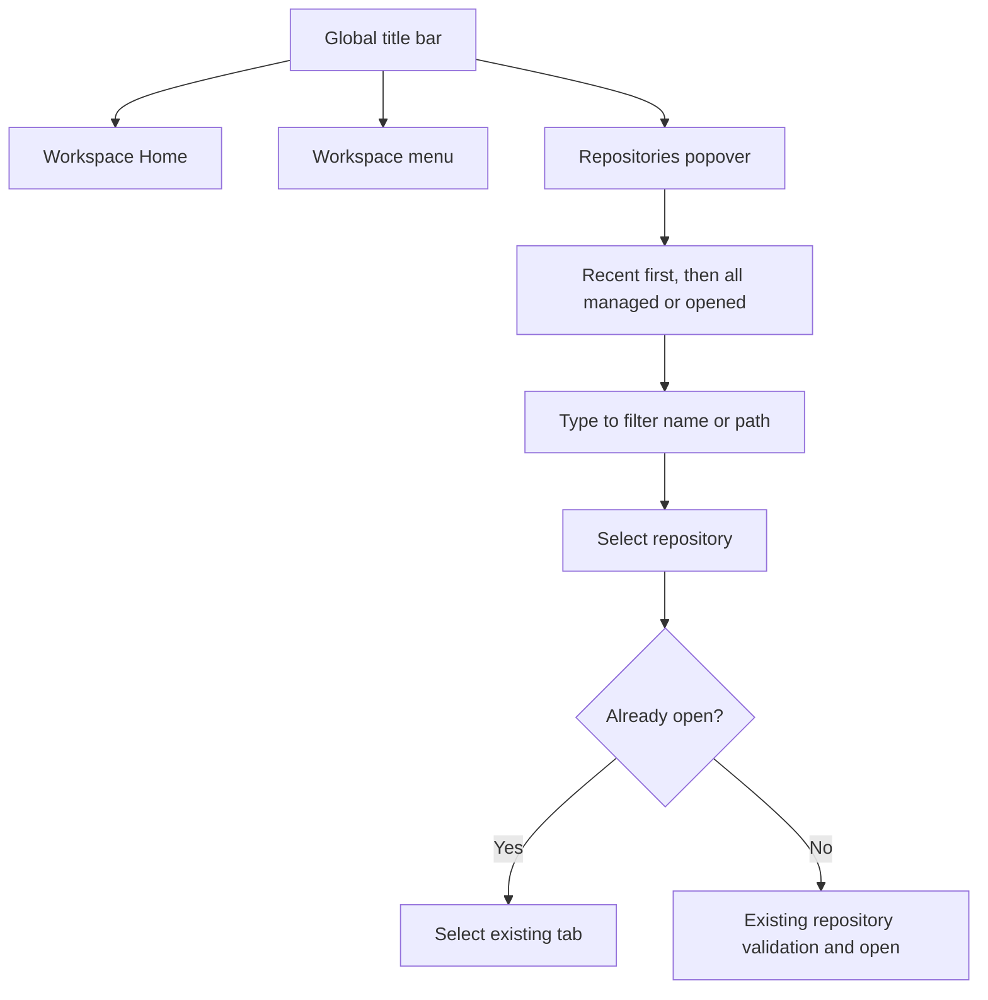
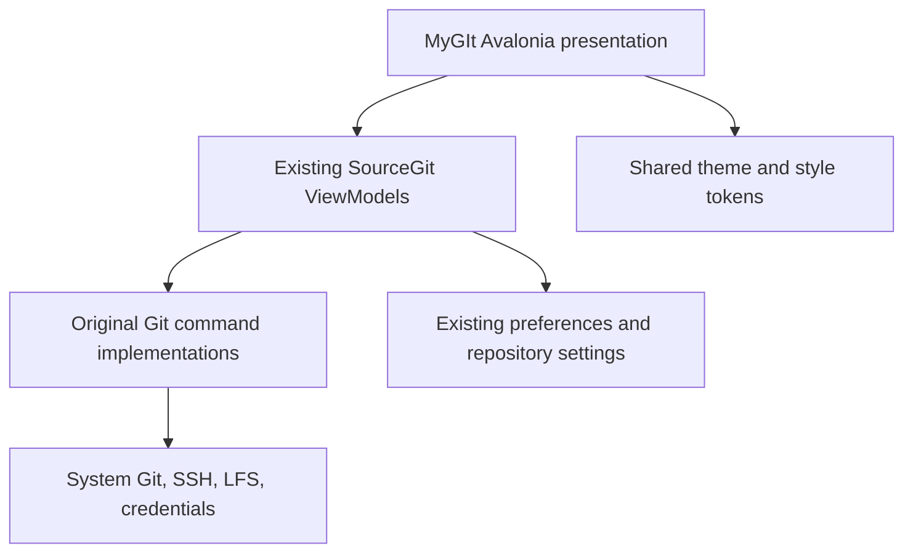

# MyGIt UI implementation handoff

> Source: `buildHelpers/MyGIt`. The redesign started at `develop@37bd1fbd` and is maintained in `task/20261106-1718-workspace-navigation-redesign`. SourceGit's MIT license, Git command implementations, data formats and namespace remain intact.

## What is implemented

| Design screen | Implemented repository surface | Notable behavior |
|---|---|---|
| 01 · Workspace Home | `Welcome.axaml`, `Welcome.cs` | Live workspace name/counts, recent repository cards, managed repository tree, Clone/Open/Search |
| 02 · Working Copy | `WorkingCopy.axaml`, `DiffView.axaml` | File list, inline diff, **fixed right-side** commit composer; stage/unstage/commit/AI actions remain bound to original view models |
| 03 · Commit History | `Histories.axaml`, `CommitDetail.axaml` | Side-by-side commit graph and details by default on new installations, larger rows, current graph/search/filter behavior retained |
| 04 · Branches & Worktrees | **New** `BranchesOverview.axaml[.cs]`, `Repository.cs` | Fourth repository view, searchable existing branch sidebar retained elsewhere; branch table, HEAD/upstream details, worktree cards, checkout/create/open via original services |
| 05 · Conflict Resolution | `MergeConflictEditor.axaml`, `Conflict.axaml` | Three-way diff/editor retained, clearer panel boundaries, toolbars, and conflict status |
| 06 · Settings | `Preferences.axaml`, `RepositoryConfigure.axaml` | Left-hand category navigation, resizable settings dialogs, scrollable content, existing Git/AI/security settings preserved |

The global shell (`Launcher.axaml[.cs]`, `LauncherPage.axaml`, `Repository.axaml`, `RepositoryToolbar.axaml`) now has a branded header, persistent workspace home, separate workspace selector, and a repository button that opens a searchable recent list directly. The repository view uses a labeled left sidebar and synchronized horizontal tabs. The same theme tokens/styles are applied to Stashes and Diff.

## Recent repository switching

Recent paths are persisted in the existing `preference.json`, deduplicated and capped at 16; no credentials or repository contents are stored.

## Scope and protections

- No Git command implementation was rewritten or replaced. Existing advanced functions (merge, rebase, cherry-pick, LFS, GitFlow, submodules, worktrees, patch, logs, filters, etc.) continue to use the existing SourceGit implementation and dialogs.
- Closing tabs, branch switching, remote pushes, resets and destructive operations retain their existing backend behavior. The new workspace home and recent switcher do not issue Git writes.
- SourceGit executable/namespace/storage identifiers were intentionally not migrated en masse to avoid breaking resource lookup and existing preferences.
- Visual design is the *target implementation*: exact fidelity, rendered window sizing and keyboard behavior require the user's macOS acceptance run.

## Implementation layout

## Handoff: validation is intentionally left to the owner

No .NET build or macOS/Windows/Linux GUI run was completed in the editing environment. The user's requested acceptance is therefore **pending**, not silently treated as passed.

Suggested on-device acceptance:

1. `git checkout task/20261106-1718-workspace-navigation-redesign`
2. `git submodule update --init --recursive`
3. `dotnet build src/SourceGit.csproj` (with .NET 10 and repository prerequisites)
4. `python3 tools/verify_mygit_ui.py` (static XML/event/resource checks)
5. `dotnet run --project src/SourceGit.csproj`, then inspect the six screens against the supplied visual mockups.
6. In particular: switching open vs unopened repositories; recently used order after restart; workspace changes; branch overview; worktree opening; staging/diff/commit; merge conflicts; settings left navigation; light/dark; window resize and keyboard shortcuts.

Build/runtime errors and visual deviations, if any, should be recorded against the PR before merging. The work branch can remain reviewable without merging into `develop`.
