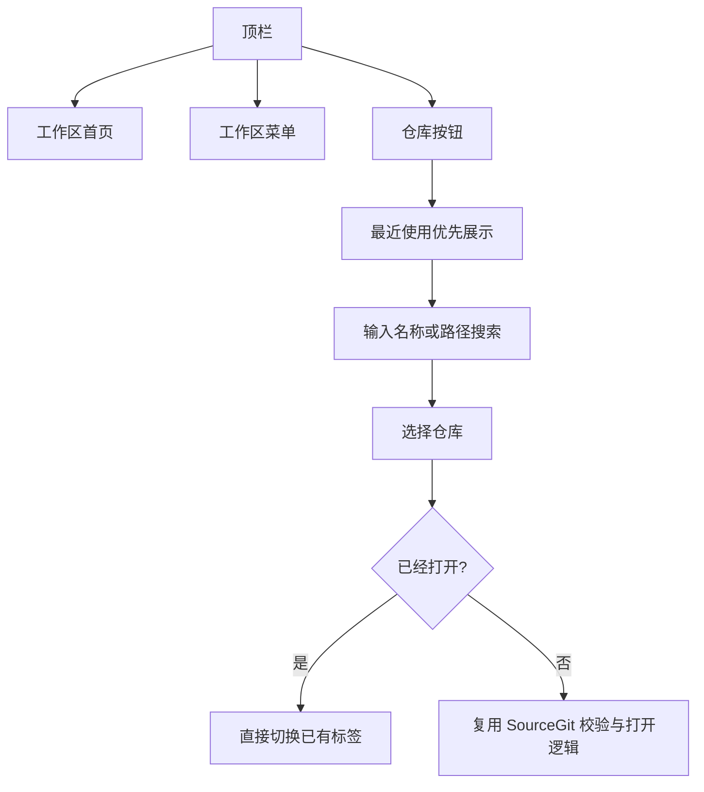

# MyGIt 界面改造 · 交接文档

> 代码仓库：`buildHelpers/MyGIt`。开发基线 `develop@37bd1fbd`，改造分支 `task/20261106-1718-workspace-navigation-redesign`。保留上游 SourceGit 的 MIT 许可、Git 核心功能、原数据格式与命名空间。

## 六张设计稿的源码落地范围

| 设计稿 | 对应实现 | 已接入的真实能力 |
|---|---|---|
| 01 工作区首页 | `Welcome.axaml`、`Welcome.cs` | 当前工作区、仓库数、最近仓库卡片、已有仓库树、搜索、克隆与打开 |
| 02 工作副本 | `WorkingCopy.axaml`、`DiffView.axaml` | 左侧变更列表、中间 Diff、**右侧固定提交编辑器**；暂存、取消暂存、提交和 AI 辅助走原有逻辑 |
| 03 提交历史 | `Histories.axaml`、`CommitDetail.axaml` | 新安装默认左右分栏，保留提交图、搜索、过滤、查看提交及变化 |
| 04 分支与 Worktrees | 新增 `BranchesOverview.axaml[.cs]`、调整 `Repository.cs` | 第四个仓库页面，分支表、当前 HEAD/上游、Worktree 卡片，复用检出、创建和打开操作 |
| 05 冲突解决 | `MergeConflictEditor.axaml`、`Conflict.axaml` | 保留三方编辑能力，统一对比窗格、边框、状态区域及操作栏 |
| 06 设置 | `Preferences.axaml`、`RepositoryConfigure.axaml` | 侧边分类标签、可调整窗口大小、滚动内容，保留 Git、AI、签名、安全等设置 |

顶部壳层（`Launcher.axaml[.cs]`、`LauncherPage.axaml`、`Repository.axaml`、`RepositoryToolbar.axaml`）已经有 MyGIt 标识、常驻工作区首页、独立工作区菜单、最近仓库搜索弹窗。仓库页面采用文字侧边栏与顶部标签同步导航；Stash、Diff、工具栏也统一了设计风格。

## 顶部仓库切换

最近使用记录保存到现有 `preference.json`，自动去重、最多 16 条，不保存密钥或代码内容。

## 保留功能与兼容边界

- **没有重写 Git 底层。** Merge、Rebase、Cherry-pick、Worktrees、LFS、GitFlow、子模块、Patch、历史日志等仍复用现有命令和弹窗。
- 回到工作区首页、切换最近仓库不会触发分支检出、Reset、丢弃修改等操作。
- 没有批量修改程序集、命名空间和本地存储目录，以免破坏现有设置与资源加载。
- 本轮完成的是各页面的**源码布局及样式实现**。是否像设计图、是否存在屏幕溢出或交互问题，需真实 macOS 运行才能确认。

## 交由用户的验收（本轮不执行）

当前编辑环境没有 .NET SDK，**尚未实际编译或运行 macOS/Windows/Linux 客户端**，不得把源码已提交描述成已通过运行验收。

用户在自己的 macOS 上可以依次执行：

1. `git checkout task/20261106-1718-workspace-navigation-redesign`
2. `git submodule update --init --recursive`
3. 使用 .NET 10 执行 `dotnet build src/SourceGit.csproj`
4. `python3 tools/verify_mygit_ui.py` 执行静态结构检查
5. `dotnet run --project src/SourceGit.csproj`，对照先前六张设计图逐页检查
6. 重点检查：最近仓库排序及重启恢复、仓库/工作区切换、多标签、工作副本三栏、分支页/Worktree、冲突解决、设置、深浅主题、窗口尺寸和快捷键

若实际编译、运行或视觉对齐存在问题，请在 PR 中记录；验收前保持独立分支，不直接合入 `develop`。
