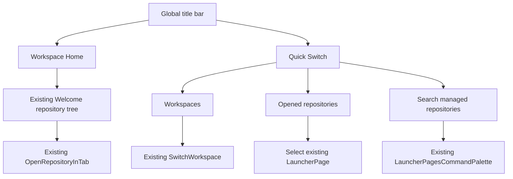

# MyGIt · UI Modernization (Increment 1)

> Base: `develop` at `37bd1fbd` (2026-11-06). This is a SourceGit-derived application; retain the upstream MIT license and notices.

## Scope implemented

- Persistent **Workspace Home** action in the application title bar. It displays the existing Welcome/Repositories page and preserves open repository tabs and working changes.
- Adjacent **Quick Switch** menu, showing all configured workspaces and all currently opened repositories. The existing searchable tabs/repositories command palette remains available for finding managed repositories that are not opened.
- Workspace home refresh: active workspace name, managed repository count, workspace count, repository tree and existing Clone/Open/Search actions; drag/drop and repository context menus remain intact.
- A calmer light/dark color palette, rounded navigation buttons, new-install light default, and MyGIt-facing window/product text. The existing SourceGit command/backend structure and extensible theme overrides remain unchanged.

## Navigation behavior

**Safety invariants:** Home navigation only selects or creates a Welcome page; it must not close repository tabs, mutate Git state, checkout branches, or discard local changes. Selecting an opened repository simply selects its existing tab. Switching workspaces intentionally continues to use the existing SourceGit workspace lifecycle.

## Key files

| File | Change |
|---|---|
| `src/Views/Launcher.axaml[.cs]` | Always-available home and quick switch |
| `src/ViewModels/Launcher.cs` | Reuse/create home page without closing tabs |
| `src/Views/Welcome.axaml[.cs]` | New workspace hero, side information and actions |
| `src/ViewModels/Welcome.cs` | Workspace and repository overview bindings |
| `src/Resources/Themes.axaml` | MyGIt light/dark palette |
| `src/Resources/Styles.axaml` | Header navigation styling |
| `src/ViewModels/Preferences.cs` | Light default for new installs |
| `src/App.axaml`, `src/SourceGit.csproj`, `src/Converters/StringConverters.cs` | Visible product branding only; assembly and namespaces intentionally unchanged |

## Verification and next increments

- [x] Branch contains the navigation handlers and their XAML bindings.
- [x] Static checks for balanced XAML tags, selected event handlers and navigation invariants.
- [ ] `dotnet build src/SourceGit.csproj` on .NET 10 SDK (not available in the editing environment).
- [ ] macOS GUI smoke test: home from 1+ repositories; switch open repository; switch workspaces; Ctrl/⌘ shortcuts; clone/open dialogs; dark mode; resize to minimum window size.
- [ ] Validate Windows/Linux system caption buttons.
- [ ] Increment 2: working-copy layout, commit composer and diff UX.
- [ ] Increment 3: history graph, branches/worktrees and conflict resolution.
- [ ] Increment 4: preferences and advanced tool entry points.

The previous design mockups illustrate target layouts. Only the features listed under **Scope implemented** are committed in this increment; visual parity across all six mockups is not yet claimed.
