# MyGIt · UI Modernization (Increment 1)

> Base: `develop` at `37bd1fbd` (2026-11-06). This is a SourceGit-derived application; retain the upstream MIT license and notices.

## Scope implemented

- Persistent **Workspace Home** action in the application title bar. It displays the existing Welcome/Repositories page and preserves open repository tabs and working changes.
- The adjacent **Workspace** menu lists configured workspaces and their settings. A separate **Repositories** button now opens a searchable list of recent and managed repositories; the original keyboard command palette remains available.
- Workspace home refresh: active workspace name, managed repository count, workspace count, repository tree and existing Clone/Open/Search actions; drag/drop and repository context menus remain intact.
- A calmer light/dark color palette, rounded navigation buttons, new-install light default, and MyGIt-facing window/product text. The existing SourceGit command/backend structure and extensible theme overrides remain unchanged.

## Navigation behavior

```mermaid
flowchart TD
    A[Global title bar] --> B[Workspace Home]
    A --> C[Workspace switcher]
    A --> D[Repositories button]
    B --> E[Existing Welcome repository tree]
    C --> F[Existing SwitchWorkspace]
    D --> G[Recent repositories and live search]
    G --> H[Existing OpenRepositoryInTab]
    E --> H
```

**Safety invariants:** Home navigation only selects or creates a Welcome page; it must not close repository tabs, mutate Git state, checkout branches, or discard local changes. Selecting an opened repository simply selects its existing tab. Switching workspaces intentionally continues to use the existing SourceGit workspace lifecycle.

## Key files

| File | Change |
|---|---|
| `src/Views/Launcher.axaml[.cs]` | Always-available home and quick switch |
| `src/ViewModels/Launcher.cs` | Reuse/create home page without closing tabs |
| `src/Views/Welcome.axaml[.cs]` | New workspace hero, side information and actions |
| `src/ViewModels/Welcome.cs` | Workspace and repository overview bindings |
| `src/Resources/Themes.axaml` | MyGIt light/dark palette |
| `src/Resources/Styles.axaml` | Header navigation styling |
| `src/ViewModels/Preferences.cs` | Light default for new installs |
| `src/App.axaml`, `src/SourceGit.csproj`, `src/Converters/StringConverters.cs` | Visible product branding only; assembly and namespaces intentionally unchanged |

## Verification and next increments

- [x] Branch contains the navigation handlers and their XAML bindings.
- [x] Static checks for balanced XAML tags, selected event handlers and navigation invariants.
- [ ] `dotnet build src/SourceGit.csproj` on .NET 10 SDK (not available in the editing environment).
- [ ] macOS GUI smoke test: home from 1+ repositories; switch open repository; switch workspaces; Ctrl/⌘ shortcuts; clone/open dialogs; dark mode; resize to minimum window size.
- [ ] Validate Windows/Linux system caption buttons.
- [ ] Increment 2: working-copy layout, commit composer and diff UX.
- [ ] Increment 3: history graph, branches/worktrees and conflict resolution.
- [ ] Increment 4: preferences and advanced tool entry points.

The previous design mockups illustrate target layouts. Only the features listed under **Scope implemented** are committed in this increment; visual parity across all six mockups is not yet claimed.

## Increment 1B · recent repositories from the title bar

Click the new **Repositories** button beside the workspace switcher to open an anchored popover immediately. The popover includes:

- Recent repository paths first, newest activation at the top; visual markers distinguish recent and already-open repositories.
- An auto-focused text box that filters by repository name or full local path as the user types.
- A complete candidate list built from managed repository folders, saved workspaces, currently open tabs, and recent history (even for ungrouped repositories).
- Click to open/switch, keyboard Up/Down for selection, Enter to open, Escape to dismiss, and standard outside-click dismissal.

Repository recency is stored as a de-duplicated, bounded list of **16 paths** in the existing local `preference.json`. Activating a repository updates the list (without recording every repository while restoring tabs). No tokens, credentials, repository files, or Git history are stored. When upgrading with an empty recent list, the switcher offers currently opened repositories as a first-run fallback.

Selecting an already-open repository reuses its tab without checking out branches or running additional Git commands. Opening a repository not currently open uses the existing SourceGit repository validation and places that tab in the active workspace. Selecting a missing path preserves the popover and routes failure through SourceGit's existing notification path.

Key files: `src/ViewModels/QuickRepositorySwitcher.cs`, `src/Views/QuickRepositorySwitcher.axaml[.cs]`, `src/ViewModels/Preferences.cs`, `src/ViewModels/Launcher.cs`, `src/Views/Launcher.axaml[.cs]`, and locale resources.

Static checks: `python3 tools/verify_mygit_ui.py`; **.NET build and macOS UI smoke test are still pending**.
