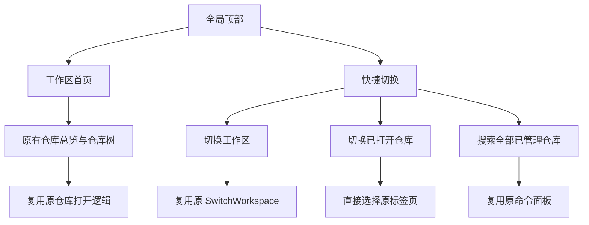

# MyGIt · 界面改造（第一阶段）

> 基线：`develop@37bd1fbd`（2026-11-06）。项目继承 SourceGit，保留其 MIT 许可证和原始版权声明。

## 已落地

- 标题栏新增常驻的 **工作区首页** 按钮。不管当前打开哪个仓库，都可以回到仓库总览；不关闭已有仓库标签页，不丢弃工作区变更。
- 旁边新增 **快捷切换**：列出已配置的工作区、已打开的仓库，以及“搜索仓库”入口。搜索复用现成命令面板，也能打开尚未打开的已管理仓库。
- 工作区首页改造：显示当前工作区名称、仓库和工作区数量；保留原来的仓库树、拖入、右键菜单、克隆、打开本地仓库及搜索逻辑。
- 统一浅色/深色主题、顶部按钮形态。新安装默认浅色，已有用户设置及主题覆盖机制保留。
- 对外展示名称逐步改为 MyGIt；底层 SourceGit 命名空间与程序集名称不动，避免误伤资源引用和已有配置。

## 操作流程

**关键限制：** 回到首页只是切换页面，不能修改 Git、检出分支、丢弃变更或关闭仓库。切换工作区暂时继续使用原 SourceGit 的生命周期处理，跨工作区复用全部进程状态尚未改造。

## 源码关联

| 模块 | 文件 |
|---|---|
| 全局标题栏/快捷切换 | `src/Views/Launcher.axaml[.cs]` |
| 返回首页逻辑 | `src/ViewModels/Launcher.cs` |
| 工作区首页布局与操作 | `src/Views/Welcome.axaml[.cs]` |
| 工作区/仓库数量 | `src/ViewModels/Welcome.cs` |
| 浅色/深色和按钮样式 | `src/Resources/Themes.axaml`、`Styles.axaml` |
| 默认主题 | `src/ViewModels/Preferences.cs` |
| 品牌文字 | `src/App.axaml`、`SourceGit.csproj`、`StringConverters.cs` |

## 验证与后续

- [x] 已检查新界面按钮与事件处理函数的对应关系。
- [x] 已执行 XAML 标签平衡、导航安全不变量的静态检查。
- [ ] **尚未完成 .NET 10 编译和实际桌面运行验证**（当前执行环境没有 .NET SDK）。
- [ ] macOS：至少打开两个仓库后回首页、切换仓库、切换工作区、检验关闭弹窗与未提交更改、浅色/深色、最小窗口宽度。
- [ ] Windows/Linux：标题栏系统按钮和菜单布局。
- [ ] 第二阶段：工作副本、Diff、提交面板。
- [ ] 第三阶段：提交历史、分支/Worktrees、冲突处理。
- [ ] 第四阶段：偏好设置及高级工具入口。

之前的六张设计图是**目标效果**，不是已经完成的界面截图。本阶段提交仅包含上面“已落地”的内容，不能宣称六个页面已经完全对齐。
