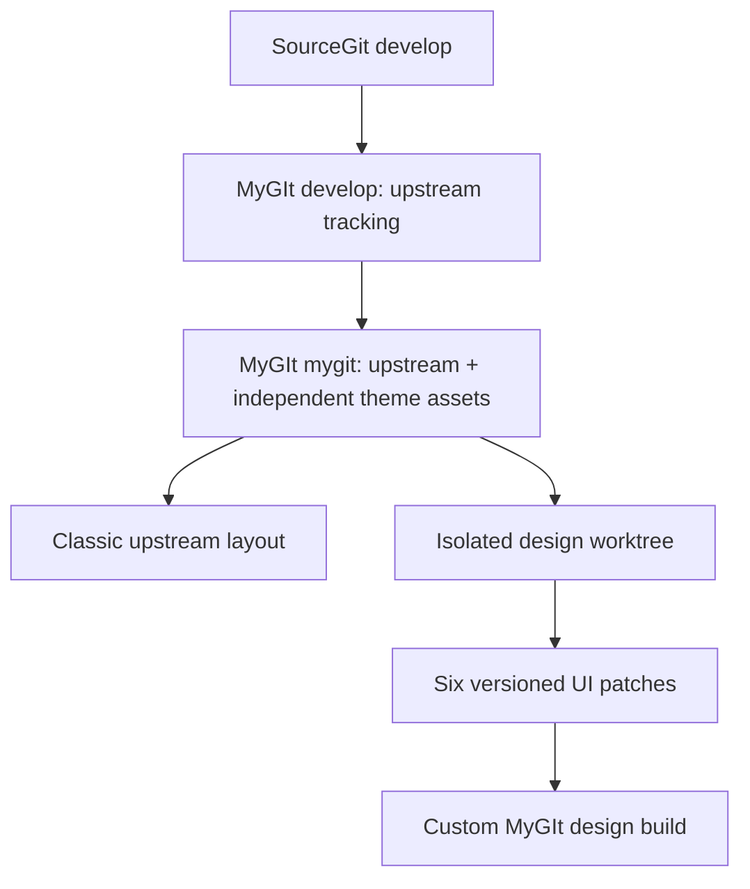

# MyGIt · Complete Design Theme System

**A theme is the complete visual experience: layouts, navigation, controls and palettes.**

This pack makes the originally approved six-screen MyGIt design available as a **buildable layout theme**, alongside SourceGit's unchanged classic interface and native Light/Dark appearance presets. No MyGIt-specific code is committed to the upstream-tracking `src/` tree on the `mygit` branch.

[中文说明](README_cn.md) · [SourceGit upstream](https://github.com/sourcegit-scm/sourcegit) · [Official appearance override specification](https://github.com/sourcegit-scm/sourcegit-theme)

## Theme architecture

| Layer | What it changes | When it switches |
|---|---|---|
| **Layout · MyGIt Design** | Workspace home, global navigation, 3-pane working copy, history, branch/worktree view, conflict editor and settings | Applies six versioned UI overlays in an **isolated Git worktree**, then rebuilds |
| **Layout · SourceGit Classic** | The original unmodified upstream interface | Use ordinary SourceGit or prepare an unmodified checkout |
| **Appearance · Light / Dark** | Window colors, controls, diff highlights, conflict colors, commit graph palette | SourceGit's native **Preferences → Appearance → Theme Overrides**, no rebuild |

**Technical limitation:** SourceGit's native `ThemeOverrides` JSON does not support replacing layouts or adding controls. The complete design is therefore a **build-time layout theme**, not a runtime layout hot-swap. A future upstream extension point could make layout switching native.

## Six design surfaces

1. Workspace dashboard with recent repository cards, tree, search and clone/open actions.
2. Global toolbar with workspace home, workspace dropdown and searchable recent-repository dropdown.
3. Working copy with separate changes, Diff, and persistent commit composer columns.
4. History graph with adjacent commit details, plus the dedicated branches/worktrees page.
5. Three-way conflict resolution with distinct compare and result panels.
6. Resizable settings with left-hand categories.

The overlay is extracted from the earlier dedicated UI implementation branch into six auditable patch groups. SourceGit Git commands, storage and backend implementations remain upstream-owned. **Visual pixel parity and macOS compilation have not yet been verified.**

## Build the complete design

Requires Git and Python 3.9+. Building and running SourceGit requires the upstream toolchain (including .NET 10).

```bash
# In buildHelpers/MyGIt checked out on the mygit branch:
python3 mygit-themes/tools/theme.py layouts
python3 mygit-themes/tools/theme.py validate

# Check upstream compatibility in a disposable detached worktree:
python3 mygit-themes/tools/theme.py check mygit-design

# Prepare a new detached worktree without changing this checkout:
python3 mygit-themes/tools/theme.py prepare mygit-design --output ../MyGIt-Design

# Build and launch from the separate output:
cd ../MyGIt-Design
git submodule update --init --recursive
dotnet run --project src/SourceGit.csproj
```

Or prepare and build in one command:

```bash
python3 mygit-themes/tools/theme.py build mygit-design --output ../MyGIt-Design-Build
```

The output directory must not already exist, and it must be outside the source checkout. All patches are checked before applying, and a failed patch aborts the operation. The source checkout, upstream-tracking branches, native Git configuration, credentials and `preference.json` are not rewritten by the composer.

To use the upstream classic layout:

```bash
python3 mygit-themes/tools/theme.py prepare upstream-classic --output ../SourceGit-Classic
```

## Apply a light/dark palette

Select [MyGIt Light](presets/MyGIt-Light.json) or [MyGIt Dark](presets/MyGIt-Dark.json) under **Preferences → Appearance**: set the matching base Light/Dark theme and then select the JSON in **Theme Overrides**. No rebuild is required for color-only changes.

The optional installer copies the JSON to a stable local config directory but does not modify preferences:

```bash
python3 mygit-themes/tools/theme.py install light
python3 mygit-themes/tools/theme.py install dark
```

## Upstream sync and compatibility



To sync: fast-forward the fork's `develop` from the upstream `develop` branch, merge those updates into `mygit`, then run `python3 mygit-themes/tools/theme.py check mygit-design` on your clean checkout. A failed patch signals that the **theme's UI adaptation needs attention**, not that Git behavior may be silently overwritten.

All MyGIt-specific assets are in this directory, but the six layout patches remain coupled to upstream XAML/ViewModel structure. Consequently, **this is easier to maintain than a permanently modified upstream branch, but not maintenance-free**.

## Layout package inventory

```text
mygit-themes/
├── manifest.json
├── presets/MyGIt-{Light,Dark}.json
├── layouts/mygit-design/patches/
│   ├── 00-adapters.patch
│   ├── 10-shell-home.patch
│   ├── 20-working-copy.patch
│   ├── 30-history-branches.patch
│   ├── 40-conflicts-settings.patch
│   └── 50-visual-resources.patch
└── tools/{theme.py,layout.py}
```

**Acceptance status:** Packaged implementation, GitHub review and static checks are in progress; full build, launch and screenshots remain for owner validation.
