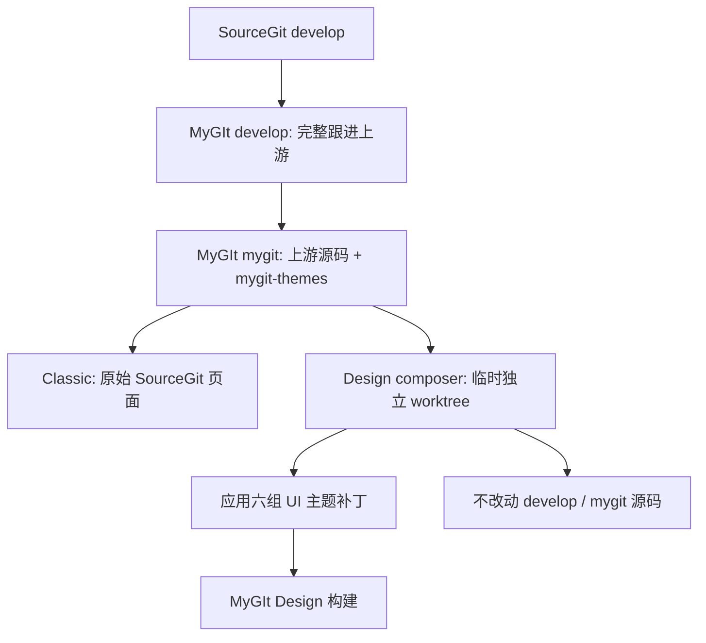

# MyGIt · 完整设计主题系统

**主题 = 页面布局 + 导航交互 + 控件样式 + 浅色/深色配色。**

这是最初确认的六张 MyGIt 设计稿的**界面实现包**，不再把“主题”理解为单纯修改颜色。SourceGit 的 Git 命令、数据和工作流仍由上游维护。为方便同步上游，所有自定义内容放在 `mygit-themes/`，`develop` 与 `mygit` 分支不直接提交对上游 `src/` 的私有改动。

[English](README.md) · [SourceGit 上游](https://github.com/sourcegit-scm/sourcegit) · [官方原生主题规范](https://github.com/sourcegit-scm/sourcegit-theme)

## 主题的两层结构

| 层级 | 包含的内容 | 切换方式 |
|---|---|---|
| **布局主题 · MyGIt Design** | 工作区首页、三栏工作副本、历史、分支/Worktrees、冲突解决、设置及顶部导航 | 准备独立构建目录，重新构建；不修改原版仓库 |
| **布局主题 · SourceGit Classic** | 原生 SourceGit 完整界面 | 使用原版程序，或生成未打补丁的独立目录 |
| **外观主题 · MyGIt Light/Dark** | 背景、文字、圆角配色、Diff、提交图等 | 原版 **Preferences → Appearance → Theme Overrides**，不需编译 |

**技术边界必须明确：SourceGit 原生 JSON 主题没有布局替换能力。** 因此完整设计布局目前由版本化界面补丁装配到**单独的 Git worktree**，属于“需要重新构建的布局主题”，而不是运行时即刻热切换。未来如果 SourceGit 上游提供替换页面的标准扩展接口，可以将这套布局包迁移过去。

## 完整设计包含什么

- **工作区首页**：自定义布局、最近仓库卡片、搜索、克隆/打开本地仓库、真实仓库树。
- **顶部导航**：常驻返回工作区、独立工作区菜单、最近仓库列表与即时名称/路径搜索、原仓库标签。
- **工作副本**：左侧变更文件、中间 Diff、右侧提交编辑器，保留暂存/撤销暂存/提交/AI 辅助。
- **历史**：提交图与详情默认左右分栏，保留原有筛选及历史操作。
- **分支与 Worktrees**：新增分支与 Worktree 管理页，操作复用 SourceGit 原来的代码。
- **冲突**：重构三方差异和结果区域的视觉布局，保留原冲突处理逻辑。
- **设置**：全局与仓库设置采用较宽窗口及左侧分类，保留原设置行为。

这套界面包来源于先前独立分支中已经提交的布局改造代码，并拆分成六个有序、可审阅的补丁。**尚未在 Mac 真实编译及逐页截图验收，因此不能宣称与原设计稿像素完全一致。**

## 使用 · 默认完整设计

要求本地有 Git、Python 3.9+；编译程序需要 .NET 10 SDK 和 SourceGit 原有的构建依赖。

在 `buildHelpers/MyGIt` 的 `mygit` 分支中：

```bash
# 查看可用主题
python3 mygit-themes/tools/theme.py layouts
python3 mygit-themes/tools/theme.py list

# 验证所有主题资源和布局补丁格式
python3 mygit-themes/tools/theme.py validate

# 不改变任何持久工作区：创建临时工作树检查当前上游能否应用布局
python3 mygit-themes/tools/theme.py check mygit-design

# 生成 MyGIt 完整设计的独立源码目录；目标目录必须不存在
python3 mygit-themes/tools/theme.py prepare mygit-design --output ../MyGIt-Design

# 在生成目录安装原有子模块并启动（不改变上游 checkout）
cd ../MyGIt-Design
git submodule update --init --recursive
dotnet run --project src/SourceGit.csproj
```

也可以一步创建独立目录并尝试编译：

```bash
python3 mygit-themes/tools/theme.py build mygit-design --output ../MyGIt-Design-Build
```

构建工具只会操作新生成的工作树和其子模块，原 `develop` / `mygit` 分支源码不受影响；如果上游版本不兼容，会报错并停止，而不是静默覆盖。已有目标目录不会自动覆盖。不要把生成目录里的修改提交回上游跟踪分支。

使用原版布局：

```bash
python3 mygit-themes/tools/theme.py prepare upstream-classic --output ../SourceGit-Classic
```

## 浅色/深色主题

同一款完整设计布局提供两套配色：

- [MyGIt Light](presets/MyGIt-Light.json)：浅灰白背景、蓝紫点缀。
- [MyGIt Dark](presets/MyGIt-Dark.json)：深蓝色背景、低眩光。

在应用 **Preferences → Appearance** 里先选择 `Light` 或 `Dark`，然后选择对应的 JSON 作为 **Theme Overrides**；这一步无需编译。

如需单独复制外观主题到系统目录，也可运行：

```bash
python3 mygit-themes/tools/theme.py install light
python3 mygit-themes/tools/theme.py install dark
```

## 为什么这样更利于同步上游



**需要持续维护的只有主题目录，但主题内的布局补丁依然依赖上游 XAML/VM 的结构。** 若上游更新了对应页面，补丁检查可能失败，这时需要适配；它不是“永不维护”。与直接长期修改 `develop` 的 48 个源文件相比，独立补丁使变更更容易追踪，能明确发现不兼容。

## 文件结构

```text
mygit-themes/
├── manifest.json
├── presets/
│   ├── MyGIt-Light.json
│   └── MyGIt-Dark.json
├── layouts/mygit-design/patches/
│   ├── 00-adapters.patch
│   ├── 10-shell-home.patch
│   ├── 20-working-copy.patch
│   ├── 30-history-branches.patch
│   ├── 40-conflicts-settings.patch
│   └── 50-visual-resources.patch
└── tools/
    ├── theme.py              # 统一命令入口
    └── layout.py             # 隔离布局构建逻辑
```

下一步由用户在 macOS 上编译、运行及与六张效果图逐页对比；未验收前不声明程序已经达标。
